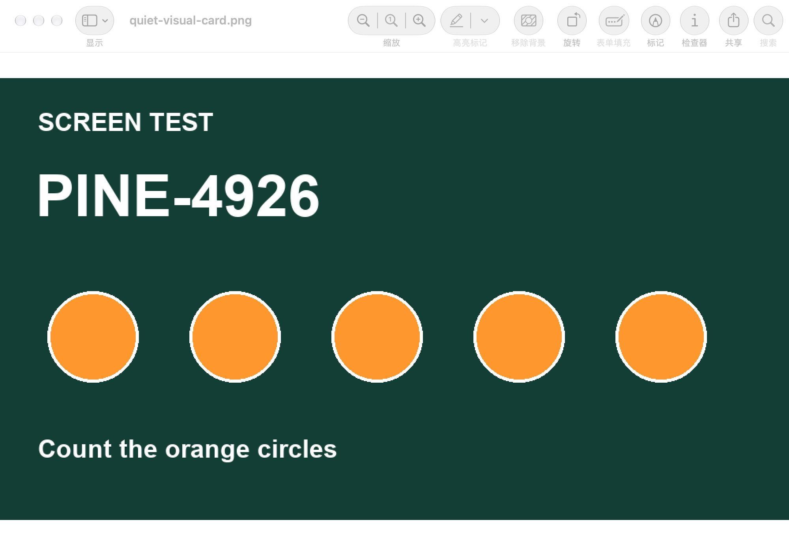
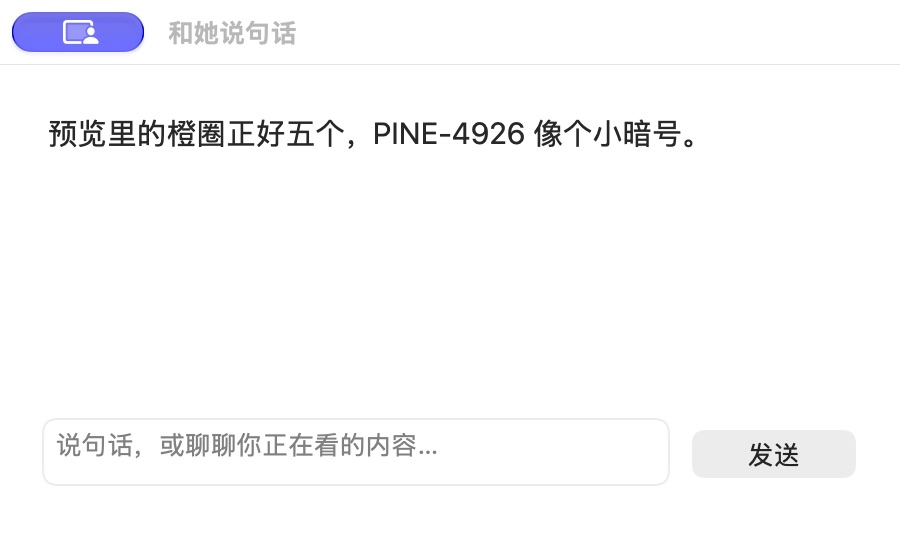
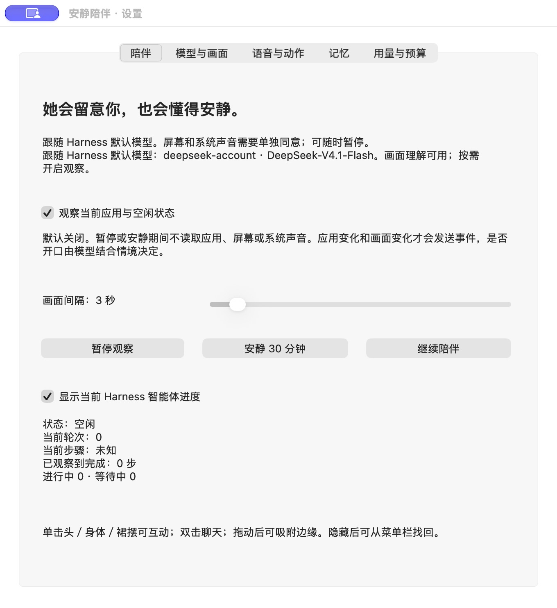
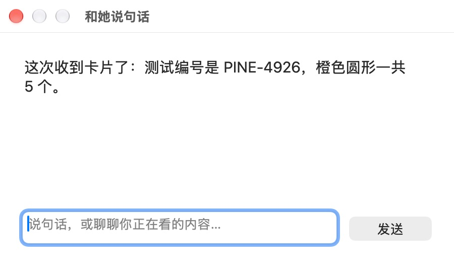
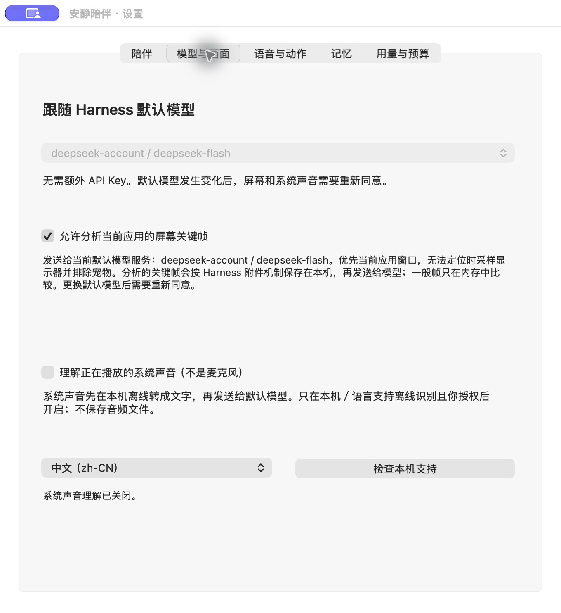
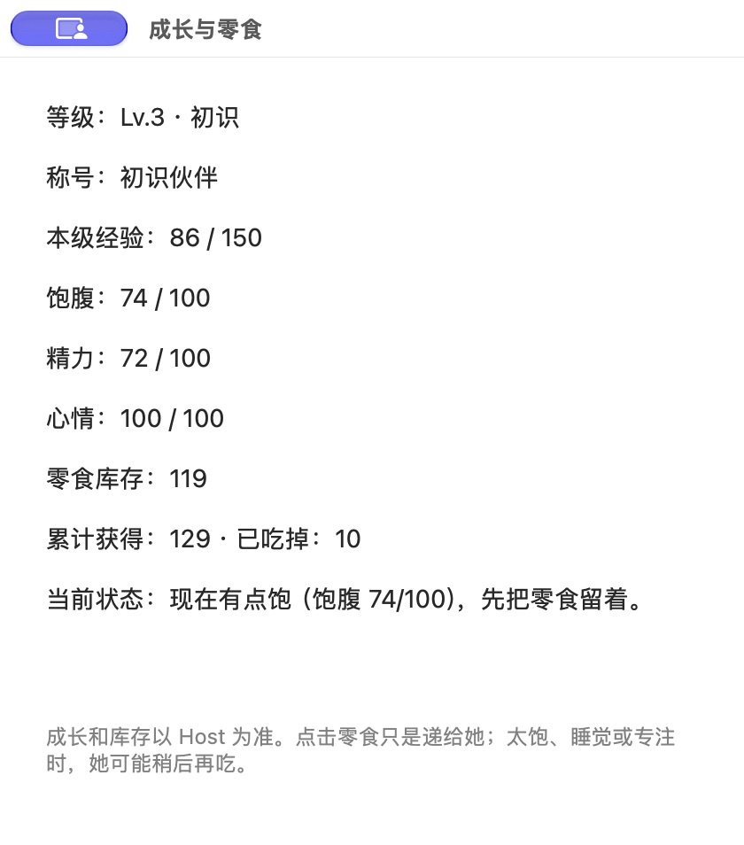
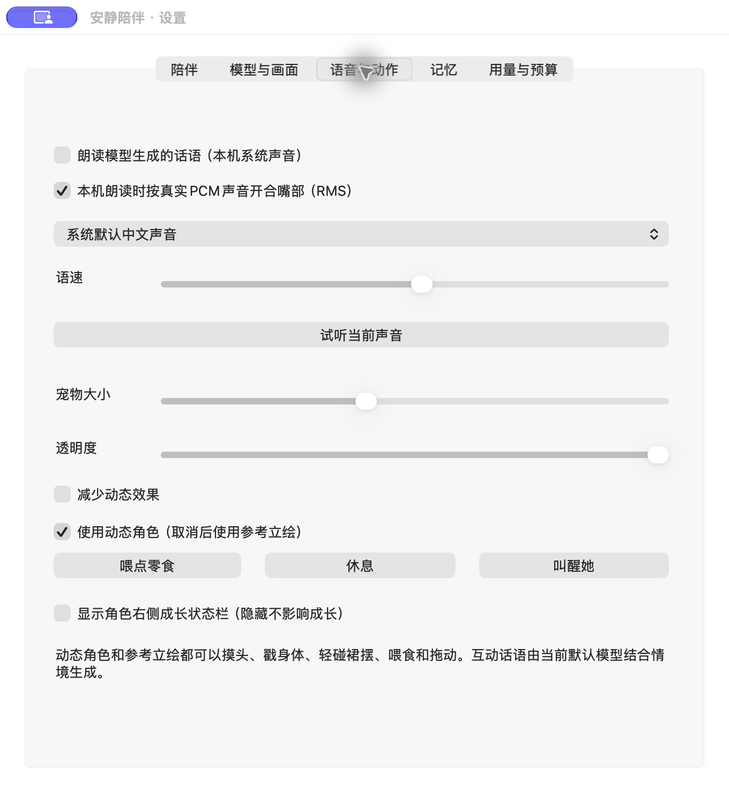

<div align="center">

# 安静陪伴 · Quiet Companion

**在你工作、浏览和看视频时，能聊两句，也懂得安静陪着你的桌面伙伴。**

[发行版本](https://github.com/Chertuion/dsh-quiet-companion/releases) · [使用指南](docs/guide.md) · [更新记录](CHANGELOG.md) · [问题反馈](https://github.com/Chertuion/dsh-quiet-companion/issues)


*2026-11-05 · v0.5.1-beta.9 实测截图。成长栏收起时，零食仍围在角色身边，顶部显示当前空闲状态。*

</div>

安静陪伴是运行在 [DeepSeek Harness](https://github.com/deepseek-ai/deepseek-harness) 中的 **macOS 桌面陪伴插件**。她沿用 Harness 当前默认模型，结合经你开启的应用、画面和视频对白上下文，选择合适的时候关心或调侃；文字交流、可管理的记忆、真实 Agent 状态和身边的虚拟零食，共同构成日常陪伴。

角色风格是安静、体贴，带一点黏人与俏皮。主动回应由事件与上下文决定，模型可以选择保持安静。角色随 Harness 启停，使用官方桌面版时不需要一直开着终端。

> **当前版本：[`v0.5.1-beta.9`](https://github.com/Chertuion/dsh-quiet-companion/releases/tag/v0.5.1-beta.9)**，已公开并安装验证。支持 Apple Silicon Mac、macOS 14及以上、官方 Harness 桌面版 `0.2.1-rc.5`。直接跳到[安装步骤](#安装到官方桌面版)。

本文配图来自已安装版本的实际窗口，保留原始截图内容。测试卡为自有测试内容，主动评论与手动问答均来自真实运行；成长数值为拍摄时的本机状态。截图来源、各图范围与原始文件校验见[截图说明](docs/assets/screenshots/README.md)，功能验收条件见[验证记录](docs/development.md#beta9-validation)。

## 目录

- [她能做什么](#她能做什么)
- [Q版动作与语音口型](#q-animation)
- [支持环境](#支持环境)
- [安装到官方桌面版](#安装到官方桌面版)
- [第一次使用](#第一次使用)
- [日常操作与设置](#日常操作与设置)
- [零食成长与用量口径](#零食成长与用量口径)
- [记忆如何工作](#记忆如何工作)
- [权限与数据去向](#权限与数据去向)
- [更新卸载与恢复](#更新卸载与恢复)
- [常见问题](#常见问题)
- [第三方项目与来源](#第三方项目与来源)
- [开发与验证](#开发与验证)
- [许可与反馈](#许可与反馈)

## 她能做什么

### 沿用默认模型交流

双击角色可以文字聊天，摸头、轻戳、碰裙摆等互动也可以触发模型回应。模型沿用 Harness 的当前默认配置，不需要在插件里重复填写 API Key；更换默认模型后，插件跟随实际的供应商与模型标识。

头部、身体衣物和裙摆作为不同互动传给模型，回应可结合对应部位生成；每次调用还提供实际系统日期、时间与时区，避免把旧截图或记忆里的日期当成现在。

部位互动和自动观察使用不超过90个字符的自然短回应，自动观察还可明确选择沉默。手动文字聊天使用独立的结构化回复协议；每条路径均验证完整结果，不自动重试失败调用。协议与生成额度见[开发记录](docs/development.md#beta7-validation)。

陪伴对白由模型生成。启动说明、权限状态、升级提示等界面信息由本机程序提供。聊天、主动评论和记忆整理会产生正常模型调用费用，使用前可在设置里查看或调整插件自己的日预算。

### 根据情境主动说话，也能保持安静

开启观察后，应用切换、明显画面变化、新的视频对白、用户互动和任务事件会成为判断线索。系统结合事件新鲜度、最近是否与她交流、此前发言是否被忽略、会议应用、离开状态和预算，决定是否请求模型回应。

感知采样有检查间隔，主动发言没有“每隔几分钟必须说一句”的循环。模型还可以判断没有值得说的内容。你可以增加安静应用、暂停观察，或临时安静30分钟；手动聊天仍可独立使用，但同样受模型可用性和插件预算限制。

<table>
  <tr><th>当时的前台窗口</th><th>她主动生成的回应</th></tr>
  <tr>
    <td></td>
    <td></td>
  </tr>
</table>

*2026-11-05 · v0.5.1-beta.9 实测截图。将“预览”中的自有测试卡置于前台后，仅恢复观察，没有向宠物发送聊天消息；默认模型根据本次事件生成了右图回应。这是一例真实主动开口，不是固定台词，也不表示每次切换应用都必须回应。*

<details>
<summary>查看实测设置：应用感知、采样间隔与暂停入口</summary>



*2026-11-05 · v0.5.1-beta.9。原生设置窗口中的“陪伴”页，拍摄时观察已开启、采样间隔为3秒，Agent为空闲。图中同时展示了观察开关、采样间隔与暂停入口。*

</details>

### 看当前画面，结合视频对白理解上下文

画面理解需要你单独开启、同意向当前默认模型发送图片，并授予 macOS 屏幕录制权限。默认模型还须明确支持图片输入，且 Host 附件服务可用。

当前实现优先采样前台应用窗口，必要时退回排除宠物的显示器画面。本机先判断变化，有事件需要理解时才选择最近最多 **3个关键帧**交给模型；默认采样间隔3秒，可设为1–30秒。实际速度还受系统调度、画面捕获和模型响应影响。



*2026-11-05 · v0.5.1-beta.9 实测截图。将自有测试卡置于前台、确认收到有效帧后，用不含答案的问句手动询问；Harness 默认 Flash/Max 返回图中的编号和数量。这是一次受控画面识别结果，不代表任意画面或视频都能准确理解。*

“听视频对白”是另一个独立功能：通过 macOS 捕获系统播放声，在本机离线转写，再将可用的短转写交给默认模型。支持选择普通话与美国英语，取决于本机识别资源是否可用。当前没有持续麦克风对话、用户开口打断 AI，或对整段视频逐帧、无延迟的理解能力。

此前在同字节原生 build9 中，播放14秒自有合成语音后，默认模型正确复述了书本与白云两个预设关键词；beta9另验证了声音开启、运行状态与关闭。两项条件分别记录在[实测记录](docs/development.md#beta9-validation)，不扩展为任意视频、语言或重复次数的准确性。

<details>
<summary>查看实测设置：跟随默认模型，画面与系统声音分别开启</summary>



*2026-11-05 · v0.5.1-beta.9。原生设置窗口中的“模型与画面”页，拍摄时画面已开启、系统声音关闭。灰色模型选择器表示跟随 Harness 默认配置；画面与系统声音可分别管理。*

</details>

### 在桌面查看真实 Agent 状态

角色顶部与“进度与用量”页显示当前 Host 实际提供的思考、工具执行、等待回答、等待审批、完成和错误状态，并在有数据时展示任务名称、工具、轮次和已观察到的步骤。

进度来自 Harness 会话事件。上游没有提供总步骤或完成率时，界面显示阶段和已知信息，不生成一个看似精确的百分比。当前 Host 的子 Agent 事件可以参与统计；其他应用或其他 Harness 进程不在本插件的监听范围内。


*2026-11-05 · v0.5.1-beta.9 实测截图。Harness 执行一次 Python 标准库等待20秒后打印系统时间的只读任务，结束后桌面角色顶部显示“已完成”。角色顶部的状态来自该次真实任务的结束事件。*

<details>
<summary>查看同次任务的思考阶段：轮次1、步骤1、进行中1</summary>


*2026-11-05 · v0.5.1-beta.9。同一次任务的“思考中”阶段，轮次1、步骤1、进行中1；此时应用观察关闭，Agent事件仍独立更新。两张图分别记录了同次任务的思考和完成阶段。*

</details>

### 身边的零食与温和成长

启用后新上报的真实 token 可以积累为虚拟零食。零食出现在角色左右和脚边，她会根据饱腹、精力、休息和任务状态选择什么时候吃；你也可以点击零食递给她。

成长包括等级、经验、熟悉阶段、饱腹、精力和心情。右侧成长栏默认隐藏，完整信息在设置中查看。日常互动也能获得经验，无需为了成长增加模型消费；当前没有购买、充值、死亡或久别扣除关系等级的机制。详细规则见[零食成长与用量口径](#零食成长与用量口径)。



*2026-11-05 · v0.5.1-beta.9 实测截图。拍摄时为 Lv.3、经验86/150、库存119份，累计获得129份、已吃10份。当前饱腹74，普通自动进食正在等待饱腹降低；手动递食的条件见下方规则。*

<a id="q-animation"></a>

### Q版动作与语音口型

橙发花饰、抱书的 Q 版角色提供 **24类动作 × 每类8个关键姿势，共192帧画稿**：

| 类别 | 动作 |
| --- | --- |
| 日常 | 待机、等待、伸懒腰、哈欠、左右看、招手、睡眠 |
| 任务与交流 | 思考、书写、检索翻书、命令操作、成功、错误、回复、等待审批 |
| 互动 | 拖动、落地、摸头、轻戳、轻扶裙摆、进食 |
| 情绪 | 害羞、关心、俏皮 |

关键姿势采用可变时长播放，并叠加 SpriteKit 的轻微呼吸、头部与发缘网格形变，渲染目标为30fps。192帧是画稿数量，30fps是渲染目标；目前没有分层骨骼、Live2D 模型或 Live2D SDK，不同负载下的帧率和连续动作观感仍以本机实际表现为准。

开启本机朗读后，嘴部跟随 **实际播放的 TTS 音量**开合：由 PCM 的短窗 RMS 和播放器时钟驱动，不依赖文字长度，不使用麦克风，也不判断音素。静态立绘同样支持口型；“减少动态”会同时停止网格微动和嘴部动画。朗读默认关闭，口型开关默认开启，开启口型不会自动播放声音。

<details>
<summary>查看实测设置：本机朗读、口型与外观</summary>



*2026-11-05 · v0.5.1-beta.9。原生设置窗口中的“语音与动作”页，拍摄时朗读关闭、口型与动态角色开启、成长栏隐藏。图中展示的是朗读、口型与动态效果的实际配置。*

</details>

动作比较见[调研记录](docs/research.md#动作升级如何比较)。历史外观与渲染器检查图保留在[开发文档](docs/development.md#历史041验证证据)，不作本文实机案例。

## 支持环境

| 项目 | 当前范围 |
| --- | --- |
| 系统与芯片 | Apple Silicon Mac，macOS 14及以上；当前原生组件为 arm64 |
| Harness | 官方桌面版 `0.2.1-rc.5`，插件声明的 Host 版本也为该版本 |
| 安装位置 | 官方桌面版的 `desktop` profile |
| 模型 | Harness 当前默认模型；图片功能另需明确的图片输入能力 |
| 安装工具 | 桌面应用内安装即可，不要求额外安装 Node.js、pnpm、Xcode 或 Swift |
| 尚未验证 | Intel Mac、Windows、Linux、其他 Harness 版本和浏览器 WebUI 配置 |

桌面端与 WebUI 使用不同 profile。在 WebUI 中安装，不会自动装到官方桌面版。客户端清单中的 `platform: web` 表示使用 Host 的共享网页界面模块，本插件的原生角色仍依赖上述 macOS 环境。

本项目是独立社区插件，与 DeepSeek 官方无隶属关系。原生组件使用本地 ad-hoc 签名，尚未做 Developer ID 公证。

## 安装到官方桌面版

### 应用内安装〔推荐〕

1. 打开官方 DeepSeek Harness 桌面应用，点击 **插件 → 添加插件**。
2. 填入本版固定地址：

   ```text
   github:Chertuion/dsh-quiet-companion#v0.5.1-beta.9
   ```

3. 安装后启用插件，按应用提示重新打开 Harness。
4. 打开 **设置 → 安静陪伴**，确认原生组件已连接。

固定标签与同版 Release 安装包对应。升级变化见[更新记录](CHANGELOG.md)。

### 使用 Release 安装包

在对应 [Release](https://github.com/Chertuion/dsh-quiet-companion/releases/tag/v0.5.1-beta.9) 的 **Assets** 中下载 [`dsh-quiet-companion-0.5.1-beta.9.tgz`](https://github.com/Chertuion/dsh-quiet-companion/releases/download/v0.5.1-beta.9/dsh-quiet-companion-0.5.1-beta.9.tgz)，无需解压，把下载文件的完整本机路径填入“添加插件”。GitHub 自动生成的 Source code ZIP/TAR 是源码快照，不是此预编译安装包。GitHub 源码拉取停滞时可选择同版已下载的 Release 安装包；旧版见[发行列表](https://github.com/Chertuion/dsh-quiet-companion/releases)。

### 使用桌面应用自带的 CLI

先启动过一次桌面应用，让它初始化配置；执行命令前完全退出 Harness。下面是默认 macOS 安装路径的例子：

```sh
"/Applications/DeepSeek Harness.app/Contents/Resources/runtime/cli/bin/dsh" \
  plugin --profile desktop add github:Chertuion/dsh-quiet-companion#v0.5.1-beta.9
```

随后重新打开应用。这里使用的是**桌面应用自带的 CLI**，不要用独立 npm 安装的 `dsh` 去修改桌面端 profile。自定义安装位置请调整路径；参考 [Harness 官方桌面端说明](https://github.com/deepseek-ai/deepseek-harness/blob/dsh-v0.2.1-rc.5/apps/desktop/README.zh.md)。

## 第一次使用

1. **先试文字交流**：双击角色，确认 Harness 默认模型能正常回应。没有配置模型时，本地角色仍可显示，模型交流需要可用的默认模型。
2. **再开需要的感知**：“感知与陪伴”中开启观察；画面与系统声音各自单独开启，并按需完成确认和系统授权。
3. **调整桌面表现**：“外观与语音”中改变大小、透明度和动态。需要说话声音时再开启朗读，口型有独立开关。
4. **查看成长与记忆**：“成长与零食”里查看库存；“记忆”里查看事实、来源和置顶内容。
5. **选择打扰程度**：增加会议或安静应用；临时不希望采集时使用“暂停观察”或“安静30分钟”。

插件沿用现有 Harness 模型配置，不单独收取模型密钥。画面、系统声音、应用感知、朗读和鼠标互动默认关闭；记忆、成长、零食奖励、自动进食、Agent 提示和动态角色默认开启。

本文设置截图来自角色右键或菜单栏可打开的原生设置窗口；Harness 的 **设置 → 安静陪伴** 另提供下述五个分区，用于管理完整设置和数据。

## 日常操作与设置

### 桌面操作

| 操作 | 效果 |
| --- | --- |
| 单击头部、身体或裙摆 | 播放本地互动动作，并可触发模型交流 |
| 双击角色 | 打开文字聊天 |
| 拖动并松开 | 移动、贴边与位置记忆，播放悬空和落地动作，拖动时停止朗读 |
| 点击身边零食 | 未激活窗口时也接收首次点击；递出指定零食，不能吃时即时说明原因，仍遵守本机门禁 |
| 右键角色或菜单栏入口 | 找回角色、聊天、设置、暂停、静音、休息、叫醒或退出 |
| 隐藏成长栏 | 收起右侧数值与库存标签，零食、成长计算和顶部 Agent 状态继续保留 |

头部、身体衣物与裙摆还提供带语义名称的 macOS 无障碍按钮；零食有“递给她：食品名”按钮。Press 操作沿用原有互动与递食处理，受显示和可用状态约束，不能绕过进食规则。它不会自动授予“鼠标撒娇”的辅助功能权限。

### 五个设置分区

| 分区 | 可以调整或查看 |
| --- | --- |
| 感知与陪伴 | 默认模型信息、观察、画面、系统声音、识别语言、采样间隔、安静应用、鼠标撒娇 |
| 外观与语音 | 显示/隐藏、大小、透明度、动态、减少动态、朗读声音与语速、语音口型 |
| 成长与零食 | 成长/奖励/自动进食开关、每份零食所需 token、库存、状态、递食与桌面成长栏 |
| 记忆 | 自动记忆开关、置顶编辑、事实与原文来源、单条遗忘和清空 |
| 进度与用量 | 当前 Agent、插件自己的今日用量与预算、费用估算，以及可用的账户余额 |

授权中会显示等待状态，错误提示不会被后台刷新立即清掉；从安静时段恢复观察会清除该次临时暂停。设置页重新可见时立即刷新诊断；读取状态不会额外采集或调用模型。

### 隐藏、休息和暂停有何区别

| 操作 | 改变什么 |
| --- | --- |
| 隐藏角色 | 隐藏窗口，同时停止动画和朗读；观察与后台模型判断另行管理 |
| 让她休息 | 影响进食/精力，不关闭观察；维持休息标记，朗读时可临时切回复姿势，结束后恢复睡姿，明确叫醒解除 |
| 暂停观察 | 停止新感知、取消插件请求，清理短期画面、转写与应用状态；已有对话历史、记忆和成长保留 |
| 安静30分钟 | 保持观察开关不变，暂缓30分钟；到期后仅仍开启且授权有效的感知继续，已暂停或重启后关闭的感知不会自动开启 |
| 关闭记忆或成长 | 分别暂停相关自动功能，保留旧记录，仍可查看和手动管理 |

完整参数与操作见[使用指南](docs/guide.md)。

## 零食成长与用量口径

### 零食如何产生

默认每 **2000个已上报 token** 奖励一份，可设100–100000。来源是监听启用后**当前 Host** 的 Agent/子 Agent 结算与伙伴自身调用；按事件身份去重，不补算历史，不统计其他应用，缺少完整用量时不猜测发奖。

桌面最多展示8份稳定位置的零食；库存可保留64份具名实体，超出的数量计入储备。桌面看不见的库存仍可在“成长与零食”页查看，状态同步不会让已有零食每次重新排列。

### 她什么时候吃

- 自动进食开启、有库存，且不处于忙碌、等待回答/审批、权限弹窗、休息或低精力状态。
- 普通自动进食要求饱腹不高于60；已有模型交流提出“想吃”时可放宽至75，手动递食可至80。
- 新零食自动进食前至少展示4秒；手动递食可跳过这4秒，但两次进食都至少相隔90秒。
- 安静时段或近期“等一等”的模型意图会暂缓进食。已有交流可以携带吃/等待意图，本机门禁仍作最终判断。

吃一份增加20经验。日常互动也可成长，但有5分钟奖励间隔与重复递减。等级、熟悉阶段、饱腹、精力和心情是角色的游戏数值；跨启动状态最多补算6小时。成长计算、奖励结算与本地自动进食本身不新增模型请求。

### 三种数字分别代表什么

| 显示 | 统计范围与限制 |
| --- | --- |
| 成长累计 token / 零食 | 当前 Host 新上报的 Agent/子 Agent及伙伴调用，用来结算虚拟奖励 |
| 插件今日用量 / 日预算 | 伙伴生成与记忆整理调用；默认日 token 预算100000，费用上限默认不启用。结算后达到预算会阻止后续模型请求，也包括手动回复；最后一次结算可能越过阈值，不能限制整个 Host 的调用 |
| 账户余额 | 只在默认供应商为 `deepseek-account` 且现有账户服务可用时查询；不支持的模型服务显示不可用 |

费用按用户填写的输入/输出单价估算，缺失用量或未配置单价时保持未知，不能当作提供商的完整账单。零食是本地虚拟奖励，没有购买、支付或真实货币兑换。

## 记忆如何工作

记忆使用本机知识图谱和中文词法检索，保留最多 **999条事实与200个文字回合**。手动聊天后，默认模型可以整理偏好、约定和经历；自动事实必须有用户原文证据，助手猜测不会直接成为用户事实。整理可能产生额外模型调用，并纳入本插件预算。

| 想做什么 | 方法 |
| --- | --- |
| 长期保留偏好或约定 | 在“记忆”中手动置顶，或在聊天中明确表达需要记住的内容 |
| 核对一条记忆 | 查看类型、主题键、ID和可用的用户原句来源 |
| 更正 | 明确表达新偏好，或编辑置顶内容；旧主题可单独遗忘 |
| 忘记一条 | 点击“遗忘”，或输入 `/forget 条目ID或主题键或完整事实`、`/忘记 内容` |
| 清空 | 在记忆页清除本插件的事实、回合和当前对话上下文 |
| 暂停自动记忆 | 关闭记忆，停止自动新增和检索；旧内容保留，手动置顶仍可编辑保存 |

遗忘会删除关联的来源回合并取消旧整理任务。当前检索是中文词法检索，不使用额外的向量嵌入服务。

原始图片和音频不写入插件的记忆库。**记忆开启时，手动文字聊天会保存用户与助手的文字回合；如果回应谈到已授权画面或对白，相关派生文字也可能保留。** 当前尚未接入独立日记、纪念日、角色卡导入、多角色人格或无限长期记忆。

## 权限与数据去向

### 开关与授权

| 能力 | 默认 | 开启后使用什么 |
| --- | --- | --- |
| 应用感知 | 关闭 | 前台应用名称、标识与空闲状态；不记录键盘输入或浏览历史 |
| 画面理解 | 关闭 | 独立的模型发送同意＋屏幕录制授权；向当前支持图片的默认模型提交选定关键帧 |
| 系统声音理解 | 关闭 | 独立同意、播放声捕获与 Speech 授权；只使用本机可用的离线转写，不调用麦克风 |
| 本机朗读 | 关闭 | macOS 已安装的系统声音，不增加语音云 API |
| 口型 | 开关开启 | 只处理插件自己朗读的音量；实际朗读发生时才可见，不新增采集权限 |
| 鼠标撒娇 | 关闭 | 独立同意和辅助功能授权；短暂轻拉指针，不点击或输入 |
| 记忆与成长 | 开启 | 本机文字记忆与虚拟状态；相关摘要可随已有调用进入默认模型上下文 |

**系统权限归属于独立原生组件“安静陪伴”**，通过 LaunchServices 启动；只给 Harness 或终端授权，不代表这个组件已获授权。首次打开系统开关后，当前进程可能仍需重启才读到生效状态。0.5.1会保留本次发送同意并显示等待或重启提示，每个宠物进程最多发起一次相应屏幕/辅助功能系统请求，不会反复弹窗。

此时先在系统设置核对“安静陪伴”，回插件点 **重新检查系统权限**；检查本身不采集、不自动开启。仍提示重启时，点 **重启宠物以应用权限**，再明确开启所需功能；也可用“取消画面/声音/鼠标开启”撤回等待请求。普通设置刷新、重启时模型尚未就绪的初始化，不会抹去此前匹配的同意；没有有效模型时不能新授予发送同意，明确关闭、暂停或实际变更模型仍会取消。完整流程见[授权等待与重启](docs/guide.md#授权后仍显示等待或需要重启)。

鼠标撒娇默认在20分钟未与她互动、且出现新的电脑活动时尝试，两次至少间隔30分钟；可将未互动门槛设为5–120分钟。每次最长1.5秒、轻拉不超过160个屏幕逻辑点，真实鼠标移动、滚动、按键或 Esc 会立即结束。按住鼠标、拖拽、会议、密码输入、系统确认或等待 Agent 确认等情形下不执行。“试一下鼠标轻拉”也沿用原生安全条件与冷却；请求发送和最近原生报告分别显示，发送成功不代表发生位移。

### 数据保存与清理

本插件主要状态位于 `$DSH_HOME/quiet-companion/`，未设置 `DSH_HOME` 时为 `~/.dsh/quiet-companion/`，包括设置、文字记忆、用量和成长。目录/文件使用私有权限，内容为本机明文。原生显示位置、大小与部分偏好另由 macOS UserDefaults 保存，系统授权由 macOS 管理。

**选中发送的关键帧会交给 Harness 附件服务，可能持久保存在共享的 `$DSH_HOME/attachments`。插件不承诺自动删除这一共享缓存。** 未选中的短期帧只在插件内存中保留；系统声音不保存原始录音，短转写短期保留后过期。

模型调用通过 Harness 的服务完成，插件不复制或保存模型密钥；选中的文字、相关记忆、图片和转写会发送给当前默认模型服务。变更实际供应商/模型标识后，画面与声音发送同意会撤销，需要重新开启。

暂停会停止新采集并清理短期画面/转写，不删除已有记忆或成长，也不能撤回已发送的内容。清除记忆、卸载插件、删除插件状态目录，均不等于清除 Host 附件缓存、原生偏好、系统授权或模型提供商的记录。更多说明见[数据与权限](docs/guide.md#权限与数据)。

## 更新卸载与恢复

应用内更新按 Harness 提示进行。旧版需要手动替换时，先停用并卸载插件包，再添加目标**已发布版本**；命令行操作前完全退出对应 Host，完成后重新打开。

插件包外的设置、记忆和成长记录不会因正常替换安装主动清除。请勿为更新删除整个 `.dsh`。原生组件断连期间不采集；“重启宠物”会取消在途请求并清理短期帧、转写，保留合法功能配置和同模型发送同意。重新连接后的采集仍须同时满足观察开启、有效同意、模型能力及真实系统授权；历史记忆与成长继续保留。

回退时使用旧 Release 的固定版本地址或对应 `.tgz`。跨版本数据兼容范围应先看[更新记录](CHANGELOG.md)，不要同时安装不同来源的同名插件。

## 常见问题

| 现象 | 先检查什么 |
| --- | --- |
| 安装后没有角色 | 核对 arm64/macOS/Host版本和 desktop profile；确认插件启用，尝试“显示宠物”或“重启宠物” |
| 设置中没有“安静陪伴” | 确认装在当前官方桌面端，重新打开 Harness，查看安装详情；WebUI配置不自动同步到桌面端 |
| 不主动说话 | 观察、安静时段、会议/安静应用、离开状态、默认模型与预算；没有新事件也可能保持安静 |
| 文字聊天也不回应 | 检查 Harness 默认模型、连接状态和插件日预算；预算会同时限制手动回复 |
| 已达到今天设置的用量预算 | 这是宠物日预算门禁，会停止新模型请求；不据此判断模型故障，也不会自动提高预算或清零用量 |
| 画面开关不可用 | 当前默认模型须声明图片能力，Host附件服务和系统授权也需可用；切换模型后重新同意 |
| 系统已允许，却仍提示授权 | 核对系统列表中的“安静陪伴”，点“重新检查系统权限”；按需重启宠物，再明确开启，勿连续重复申请 |
| 开关开启却不确定有没有收到画面 | 查看感知页的有效帧数量、最近收到时间和来源应用；重新显示设置页即可刷新。开关与授权就绪不等于已采样或识别 |
| 视频有声音却听不懂 | 检查独立系统声音开关、识别语言和本机离线资源；失败时显示状态，不自动改用联网识别或麦克风 |
| 系统声音显示“已配置；观察已暂停” | 仅表示开关已配置，当前没有捕获；恢复观察后仍须经过等待启动、正在启动与实际运行状态 |
| 聊天问画面却没有附图 | 已有帧须在45秒内且原路由、同意与画面能力仍有效；不保证角色聊天窗口在前台时会新增采样。先让目标应用处于前台并产生可见变化，再确认收到有效帧 |
| 零食没有出现 | 只计算监听启用后实际已上报的当前Host用量，检查成长/奖励开关和阈值；不会补造历史用量 |
| 有零食但不吃 | 查看休息、饱腹、精力、任务等待、安静时段和90秒冷却；递食请求也受门禁限制 |
| 模型回复格式无效 | 部位互动与自动观察使用自然短句，自动观察可明确沉默；手动聊天要求单个合法JSON对象。各自严格验证完整结果，不从无效输出猜测回复，也不自动重试 |
| 模型生成达到上限 | 明确选择Max档时，短回应上限8192 token、手动聊天16384；其他档位2048/4096，并遵守更低的同路由有效公开配置。到限显示原因，不使用半段回复、不自动重试或改变Harness推理强度 |
| 口型开启却不动 | 确认安装版本、朗读已启用、声音可用、角色可见，且未开启“减少动态”；口型自身不会开启朗读 |
| 余额/费用显示未知 | 余额仅支持现有DeepSeek账户服务；费用是有单价且有用量时的估算，未知不等于0元 |

**终端可以关吗？** 官方桌面版安装和使用不需要保留终端；Harness 必须继续运行。插件没有额外注册开机登录项或 LaunchAgent，Host 退出后不会独立观察。

完整排错、权限恢复和记忆操作见[使用指南](docs/guide.md#常见问题)。反馈时请附版本、系统/芯片、安装方式、脱敏状态与复现步骤；不要公开模型密钥、完整配置或私人屏幕内容。

## 第三方项目与来源

以下逐项链接当前实际采用的 GitHub 项目，并说明调用、适配与随包来源。**引用链接不替代原许可**；完整版权、许可正文、固定提交与改动范围见 [THIRD_PARTY_NOTICES.md](THIRD_PARTY_NOTICES.md)、[许可核查](docs/license-audit.md) 和 [third_party/](third_party/)。

### 直接依赖与提取适配

| 项目与采用版本 | 在本插件中的用途 | 许可记录 |
| --- | --- | --- |
| [MCP Memory · server-memory 2.0.1](https://github.com/modelcontextprotocol/servers/tree/194cc86e3ae6400958555bd4116849d822d69263/src/memory) | 调用知识图谱管理器保存实体、观察与关系；证据核验、置顶、纠正和遗忘由本插件包装 | [完整MCP许可](third_party/MCP-MEMORY-LICENSE.txt)，含Apache过渡及保留MIT说明 |
| [Orama 3.1.18](https://github.com/oramasearch/orama/tree/2fe41e163c2bdd7830eed7496c69134aea8ee3ba/packages/orama) | 本机全文检索，增加中文单字/双字词和近期/重要性排序 | Apache-2.0；[原始声明](third_party/ORAMA-LICENSE.md) |
| [dsh-roleplay-plugin · c2f4844](https://github.com/ajuwm/dsh-roleplay-plugin/tree/c2f4844e8e342c9a0079b7d4df419adb774bccef) | 提取适配4种食品及恢复规则，复用 `axisTier`、`repeatDimOf`；用于熟悉阶段与重复互动递减 | MIT；[完整原文](third_party/ROLEPLAY-GROWTH-LICENSE.txt)、[本地适配文件](third_party/roleplay-game-core.mjs) |

roleplay 的完整角色卡、日记、纪念日、多角色关系、小游戏和 Windows 桌宠服务没有随本项目移植。当前 token 去重、库存、经验、门禁、持久化和 macOS 展示另由本项目实现。

### 间接依赖与 SDK 附带来源

<details>
<summary>间接依赖、SDK内嵌代码与附带类型声明：完整项目和许可链接</summary>

当前插件 lock 图包含2项直接与3项间接 npm 包。SDK另将下列代码编入自己的发布文件，它们不会在本插件 lock 中全部表现为独立节点；声明映射附带的类型文件也单独列出。

| 层级 | 组件与实际版本 | 官方 GitHub 来源 | 完整许可入口 |
| --- | --- | --- | --- |
| 间接 | `@modelcontextprotocol/server@2.4.0` | [typescript-sdk 固定源码](https://github.com/modelcontextprotocol/typescript-sdk/tree/951fe5603a7ec0b2dcb6a0b95d92cd86f93ad9e5) | [SDK原文](third_party/modelcontextprotocol-server-LICENSE) |
| 间接 | `@modelcontextprotocol/core@2.4.0` | [同一SDK固定源码](https://github.com/modelcontextprotocol/typescript-sdk/tree/951fe5603a7ec0b2dcb6a0b95d92cd86f93ad9e5) | [同字节许可](third_party/modelcontextprotocol-server-LICENSE) |
| 间接 | `zod@4.6.7` | [colinhacks/zod](https://github.com/colinhacks/zod/tree/b500a2ee95134f81d74da7911d7378dd2853d042/packages/zod) | [MIT原文](third_party/zod-LICENSE) |
| SDK内嵌 | `ajv-formats@3.0.1` | [ajv-validator/ajv-formats](https://github.com/ajv-validator/ajv-formats/tree/1fb3fa7d967f919ff924bb34aef73a2f39ab0de3) | [MIT原文集合](third_party/SDK-BUNDLED-THIRD-PARTY-LICENSES.txt) |
| SDK内嵌 | `ajv@8.18.0` | [ajv-validator/ajv](https://github.com/ajv-validator/ajv/tree/142ce84b807c4fe66e619c22480a28d0e4bd50fa) | [MIT原文集合](third_party/SDK-BUNDLED-THIRD-PARTY-LICENSES.txt) |
| SDK内嵌 | `@cfworker/json-schema@4.1.1` | [cfworker/cfworker](https://github.com/cfworker/cfworker/tree/5409fdc2bd144f68e8b28c61c71fcb16600000a6) | [MIT原文集合](third_party/SDK-BUNDLED-THIRD-PARTY-LICENSES.txt) |
| SDK内嵌 | `content-type@1.0.5` | [jshttp/content-type](https://github.com/jshttp/content-type/tree/6115a4064e4dfd9845241c3f89c233ee2423deeb) | [MIT原文集合](third_party/SDK-BUNDLED-THIRD-PARTY-LICENSES.txt) |
| SDK内嵌 | `fast-deep-equal@3.1.3` | [epoberezkin/fast-deep-equal](https://github.com/epoberezkin/fast-deep-equal/tree/d807ffc5013e710deb1c63d463a03f729bcd144d) | [MIT原文集合](third_party/SDK-BUNDLED-THIRD-PARTY-LICENSES.txt) |
| SDK内嵌 | `fast-uri@3.1.8` | [fastify/fast-uri](https://github.com/fastify/fast-uri/tree/ead3ab7bb134c989e972c8174632d0670023f269) | [BSD-3-Clause原文集合](third_party/SDK-BUNDLED-THIRD-PARTY-LICENSES.txt) |
| SDK内嵌 | `json-schema-traverse@1.0.0` | [epoberezkin/json-schema-traverse](https://github.com/epoberezkin/json-schema-traverse/tree/6b45983cd76270042cc79527da5c8972f13599ec) | [MIT原文集合](third_party/SDK-BUNDLED-THIRD-PARTY-LICENSES.txt) |
| SDK附带声明 | `json-schema-typed@8.0.2` | [RemyRylan/json-schema-typed](https://github.com/RemyRylan/json-schema-typed/tree/613f3ab84c8e1b14de492534bfcb81d1499610a3) | [BSD-2-Clause原文](third_party/JSON-SCHEMA-TYPED-LICENSE.txt) |

`json-schema-typed` 来自 SDK 的类型声明映射，不是第8个运行时内嵌库。上游最新版许可不能替代已采用的8.0.2许可。本表记录当前核查版本，安装器后续按传递依赖范围重新解析时，仍需复核实际安装图。

</details>

### Host、共享界面与开发基础

<details>
<summary>Host、官方模板、共享界面与开发基础：完整项目和使用边界</summary>

| 来源 | 使用方式与分发边界 |
| --- | --- |
| [DeepSeek Harness 0.2.1-rc.5](https://github.com/deepseek-ai/deepseek-harness/tree/dsh-v0.2.1-rc.5) | 提供插件生命周期、模型、附件、会话事件、账户与设置服务；插件不重新分发整个Host |
| [官方 decoration 模板](https://github.com/deepseek-ai/deepseek-harness/tree/dsh-v0.2.1-rc.5/packages/preset/agent-preset/skills/cordis-plugin-development/templates/decoration)与[客户端消费示例](https://github.com/deepseek-ai/deepseek-harness/blob/dsh-v0.2.1-rc.5/apps/web/tests/fixtures/plugins/fixture-input-extension/client.js) | 参考模块工厂、共享模块与注册协议；设置页、controller和样式由本项目另写；[Host MIT原文](third_party/DSH-HARNESS-LICENSE.txt)完整保留 |
| [Host UI primitives](https://github.com/deepseek-ai/deepseek-harness/tree/dsh-v0.2.1-rc.5/packages/client/ui-primitives)与[settings插槽](https://github.com/deepseek-ai/deepseek-harness/blob/dsh-v0.2.1-rc.5/packages/client/ui-settings/src/client/contract/slots.ts) | 使用Host提供的Button、Switch、connection、locale与设置注册；没有另复制整套界面依赖 |
| [React / ReactDOM / scheduler](https://github.com/react/react/tree/v18.3.1) | 使用Host共享React，Host负责挂载/调度；本次Host中分别为18.3.1/18.3.1/0.23.2，插件未另打包React；ReactDOM也用于本机SSR测试 |
| [clsx 2.1.1](https://github.com/lukeed/clsx/tree/v2.1.1) | Host的Button/Switch使用它合并样式，插件没有单独导入或复制 |
| [Cordis上游](https://github.com/cordiverse/cordis)与[Harness内的fork](https://github.com/deepseek-ai/deepseek-harness/tree/dsh-v0.2.1-rc.5/vendor/cordis) | 通过Host的 `@deepseek-ai/cordis@4.0.5` 获得上下文与生命周期；采用fork保留Shigma等原MIT声明，未另打包到插件 |
| [loose-envify 1.4.0](https://github.com/zertosh/loose-envify)、[js-tokens 4.0.0](https://github.com/lydell/js-tokens) | Host共享React发布/构建图中的基础，未由本插件独立调用或打包；生产内联由Host负责 |
| [Node.js](https://github.com/nodejs/node) | 使用Host提供的运行时与内置模块；开发验证使用Node.js 24，无额外Node运行时随包复制 |

原生窗口、捕获、离线识别、网格和播放使用 macOS 的 AppKit、ScreenCaptureKit、Speech、SpriteKit、AVFoundation 等系统框架。没有为这些功能引入第三方动画引擎、口型服务或 Live2D SDK。

</details>

### 体验调研、README参考与历史素材

<details>
<summary>仅调研项目、README参考与历史素材：完整来源</summary>

以下链接保留来源，但与上述实际代码使用分开：

| 项目 | 本次参考范围 |
| --- | --- |
| [DSH 大肥鱼](https://github.com/QCYTSN/dsh-dafeiyu) | README的客户端区分、安装、常用设置、平台、排错与素材说明组织 |
| [小鲸鱼记账挂件](https://github.com/MeteorNOX/DeepSeek-Balance-Whale-Widget) | README的功能分组、数据来源、统计口径与凭据说明组织 |
| [DSH Plugin Hub](https://github.com/dshplugin/dsh-plugin-hub) | README按用户任务配图、安装/更新/反馈入口与社区项目身份说明 |
| [dsh-roleplay-plugin](https://github.com/ajuwm/dsh-roleplay-plugin) | README先讲陪伴体验，再展开机制的结构；实际提取规则已在上表另外列明 |
| [Open-LLM-VTuber](https://github.com/Open-LLM-VTuber/Open-LLM-VTuber) | 视觉与语音伙伴的产品调研，未集成其服务、代码、Live2D或语音管线 |
| [CrossPet](https://github.com/lokicorvus/crosspet/tree/5c64326b6e7fc175eda0360c0bb5c4732541d138) | 桌宠展示与文档调研，未复制图片、配置、提示词或代码 |
| [xp-level-system](https://www.npmjs.com/package/xp-level-system)、[xp-parser](https://www.npmjs.com/package/xp-parser) | 等级方案调研，未安装或打包，当前XP逻辑由本项目实现 |

本次只借鉴文档框架，正文按本插件实现重新编写，没有复制这些项目的截图、宣传结论或角色素材。固定调研版本与采纳说明见[README结构调研](docs/readme-reference.md)。

历史0.2/0.3版本曾使用 [QCYTSN/dsh-dafeiyu](https://github.com/QCYTSN/dsh-dafeiyu/tree/084323845ab82b68d5388d5c638bec09d8544a8a)和 [PC2005-cloud/dsh-pet](https://github.com/PC2005-cloud/dsh-pet/tree/549fff2ea33c2acfb16612c76912c6137da4a758)的旧动作素材，当前橙发版本已替换，旧发布保留当时的来源与许可。当前参考图按用户说明为AI图，Q版立绘与图集由图像工具生成/编辑；来源、提示、散列和嘴框记录见 [ASSET_SOURCE.md](assets/orange-character/ASSET_SOURCE.md)。软件许可不自动覆盖图片，历史动画的MIT也不转授当前素材权利。

</details>

## 开发与验证

```sh
npm ci --ignore-scripts
npm run build:client
npm test
./native/build.sh
```

源码开发需要Node.js 24及macOS/Xcode命令行工具。完整SSR测试需要可用的Host React，例如设置 `DSH_HARNESS_DIR=/path/to/deepseek-harness`；未提供时相关检查会跳过。安装发行包无需这些开发工具。

| 路径 | 内容 |
| --- | --- |
| `client/`、`client.js` | 设置界面源码与离线预构建产物，共享Host React/UI |
| `lib/` | 默认模型调用、事件策略、记忆、用量、成长和设置通信 |
| `native/` | macOS原生角色、感知、播放、动作及预编译组件 |
| `assets/orange-character/` | 当前Q版素材、清单、生成来源与口型校准 |
| `third_party/` | 提取适配模块与完整第三方许可 |
| `docs/` | 详细指南、来源、许可审计与分层验证记录 |

### 已完成的验证与范围

| 项目 | 当前证据与边界 |
| --- | --- |
| 代码回归 | beta9共227项通过、0失败、0跳过；使用实际Host React与合成协议输入，不把自动检查当作全部实机效果 |
| 公开包安装 | 先公开GitHub再安装；89个文件逐一匹配，严格签名通过，原生保持同字节build9，安装瞬间设置/成长/用量三状态保留 |
| 主动回应 | 自有测试卡置前后仅恢复观察，未发送聊天消息，实际出现按本次画面生成的主动短句；不保证每个事件都会发言 |
| 画面理解 | 一次自有测试卡的编号 `PINE-4926` 和5个橙色圆识别正确；本文聊天截图保留该次真实回复，不保证任意画面准确性 |
| Agent进度 | 一次只读时间任务的思考与完成状态实际显示，观察关闭时仍更新；未捕捉工具执行阶段，不据此验证所有任务阶段 |
| 系统声音 | beta9实际开启、显示运行并正常关闭；此前同字节组件的14秒固定音源测试正确复述两个预设关键词，不保证任意视频或全部语言 |
| 指针互动 | 用户确认真实位移；自然冷却后另测Esc取得原生接管回执，未单独测量停止延迟；不以请求送达或旧状态代替动作证据 |

完整条件、安装核对和未覆盖范围见[beta9实机记录](docs/development.md#beta9-validation)。图片、权限、模型可用性及识别质量分别验证，本文截图只展示拍摄时实际出现的窗口内容。

<details>
<summary>历史版本、权限排查与原生检查记录</summary>

- [beta8：在途观测代次与45秒接收时效](docs/development.md#beta8-validation)
- [beta7：Max生成额度与只读画面诊断](docs/development.md#beta7-validation)
- [beta6：重启保留、自动回应与受控系统声音](docs/development.md#beta6-validation)
- [beta5：配置提示、进食与裙摆回应](docs/development.md#beta5-ui-validation)
- [beta4：短期帧保留与安装复核](docs/development.md#beta4-desktop-validation)
- [beta3：部位自然回应与安装复核](docs/development.md#beta3-desktop-validation)
- [beta2：原生build9、权限/AX/音频纯检查与实际桌面复核](docs/development.md#beta2-desktop-validation)
- [屏幕权限后续核查与结论边界](docs/development.md#screen-permission-followup)
- 0.5.1-beta.1、0.5.0口型/渲染器检查与0.4.1历史界面，见[完整开发记录](docs/development.md)。这些记录保留其当时版本和测试条件，不替代当前结果。

</details>

构建、签名与协议命令见[开发与验证](docs/development.md)；使用问题优先查[使用指南](docs/guide.md)。

## 许可与反馈

自有代码当前为 **`UNLICENSED`**，仓库没有统一授予MIT许可；第三方部分继续遵守各自原许可。角色素材另见[素材来源](assets/orange-character/ASSET_SOURCE.md)，未随软件许可额外授予再分发权。引用、调研或保留原许可，也不表示获得上游作者的背书。

欢迎通过 [Issues](https://github.com/Chertuion/dsh-quiet-companion/issues) 反馈问题或建议。涉及外部代码、模型或素材的改动，请同时给出来源、具体版本、适用许可和修改范围，便于持续维护完整的归属记录。
